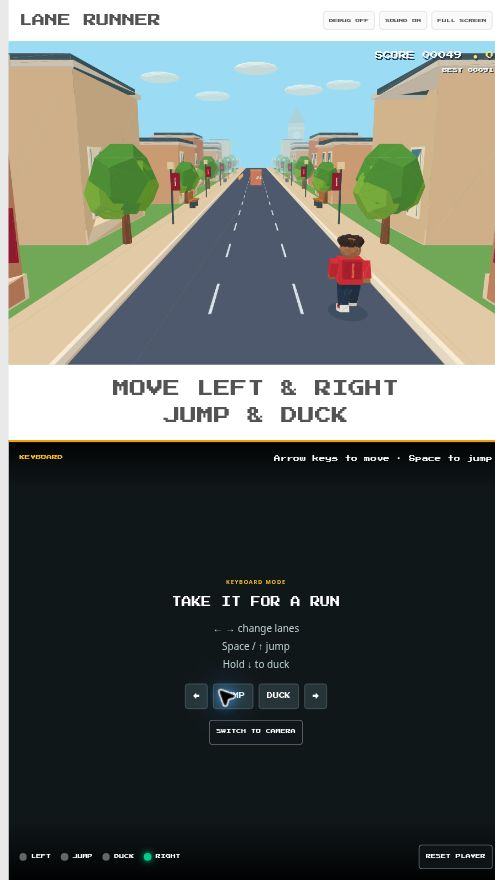

# Science Fest Games

**Your body is the controller.** Move between lanes, jump over barriers, and duck under gates using an ordinary webcam.

Lane Runner is a three-lane endless runner built with computer vision. This repository also includes Dino Jump, a body-controlled dinosaur game. Created by [Edred Azziz](https://github.com/eazziz) and demonstrated at Indiana University Science Fest 2026.



No special sensors, API keys, paid services, or backend required. Pose tracking runs locally in your browser with MediaPipe. The layout puts the game above a mirrored camera view and was designed for a portrait display; you can also try it on a laptop.

## Play on your computer

You need **Node.js 22 or newer**, npm (included with Node.js), a modern browser, and a webcam for body controls. A Chromium-based browser with hardware acceleration enabled is a good starting point. Internet access is needed to download the project and install dependencies.

1. [Download the ZIP](https://github.com/eazziz/sci-fest-dino/archive/refs/heads/main.zip) and extract it, then open a terminal in the extracted folder. Or clone it:

   ```sh
   git clone https://github.com/eazziz/sci-fest-dino.git
   cd sci-fest-dino
   ```

2. Install and start Lane Runner:

   ```sh
   npm ci
   npm run dev:runner
   ```

3. The browser should open to **http://localhost:3000/?game=runner**. If Vite uses a different port, use the URL it prints and add `?game=runner`.
4. Click **Enable Camera**, allow camera access, and step into the middle of the camera view. Keep your head, shoulders, and hips visible. Stand naturally while it calibrates, then jump to start.

Prefer to try it without a webcam? Click **Try with Keyboard** on Lane Runner's opening screen, then **Start Run**.

| Action | Body controls | Lane Runner keyboard |
| --- | --- | --- |
| Change lanes | Move left or right relative to your starting position | Left / right arrow |
| Jump | Jump upward | Space / up arrow |
| Duck | Crouch down | Hold down arrow |
| Retry after a crash | Return to the middle, let it recalibrate, then jump | Space |

Clear enough room to move comfortably. Use **Full Screen** for an event display and **Sound** to toggle audio. Stop the development server with Ctrl+C.

### Dino Jump

Run `npm run dev` and open **http://localhost:3000/**. Enable the camera, stand in the middle for calibration, then jump to begin. Jump over ground obstacles and duck under flying obstacles. The root URL continues to open Dino Jump; `?game=runner` selects Lane Runner.

## Using it at an event or in a classroom

- Position the webcam so the player's head, shoulders, and hips remain visible during movement. Even lighting and an uncluttered background help.
- Enable the camera and sound once during setup. After that, body controls let visitors play without touching the computer.
- Keep spectators outside the central play area during calibration. When one player leaves, tracking resets for the next player.
- For a vertical TV, set the display orientation to portrait in your operating system, then use **Full Screen**.
- Test your actual computer, camera, lighting, and display before the event. Tracking quality and frame rate depend on the setup.

## Camera privacy

The game processes camera frames in the browser. The application does not record or upload video, request microphone audio, or send pose data to a server. The pose model, WebAssembly runtime, and font are bundled under `public/`, so gameplay does not need an external AI service. Lane Runner saves its best score in your browser's local storage. Close the tab to release the camera.

## Troubleshooting

| Problem | What to try |
| --- | --- |
| `npm` is not found | Install Node.js, reopen your terminal, and check `node --version` and `npm --version`. |
| Camera permission is blocked | Allow camera access in both browser site settings and operating system privacy settings, then reload. |
| Camera is busy or missing | Close other camera apps, check the webcam connection, and choose the correct camera in the game's camera selector. |
| Calibration does not finish | Face forward, stand naturally with shoulders and hips visible, and keep other people out of the central area. Turn **Debug** on to see which check is waiting. |
| Tracking or rendering is slow | Enable browser hardware acceleration, close heavy tabs, and try better lighting or a different computer. |
| Camera fails on another device | Use `localhost` on the same computer, or an HTTPS deployment. A plain HTTP LAN address is not enough for camera access. |
| Model or WASM fails to load after deployment | Deploy the entire `dist/` folder at the domain root, including `models/`, `wasm/`, and `fonts/`. |

## Build and deploy

```sh
npm run build
npm run preview
```

Open the preview URL Vite prints, adding `?game=runner` for Lane Runner. This previews the production build locally; it is not a public hosted demo.

For public hosting, upload the contents of `dist/` to a static host with HTTPS. **Deploy at the domain root**, because asset paths currently start with `/models`, `/wasm`, and `/fonts`. Hosting under a subdirectory such as `username.github.io/sci-fest-dino/` needs asset-path changes first. Do not open `index.html` directly from disk.

## How it works

MediaPipe estimates body landmarks from webcam frames. A shared player session chooses a centered player and measures their standing position. Body-relative movement thresholds turn shoulder motion into jump and duck actions; Lane Runner also maps horizontal movement to three lanes. The game engine handles obstacles, collisions, coins, and difficulty, while Three.js renders the runner scene.

| File | Purpose |
| --- | --- |
| `App.tsx` | Selects the game using the `game` query parameter |
| `components/RunnerGame.tsx` | Camera, input, audio, and Lane Runner UI |
| `components/runnerEngine.mjs` | Runner rules, collisions, and obstacle patterns |
| `components/runnerScene.ts` | Procedural 3D scene and animation |
| `components/playerSession.mjs` | Player selection and automatic calibration |
| `components/poseControls.mjs` | Jump and duck detection |
| `components/runnerControls.mjs` | Body movement to lane selection |
| `components/DinoGame.tsx` | Dino Jump |
| `public/` | Local pose model, WASM runtime, font, and license notices |

## Contribute

Bug reports, setup feedback, and pull requests are welcome. See [CONTRIBUTING.md](CONTRIBUTING.md) for setup, checks, and what to include in a report.

## License and reuse

Project code is available under the [Apache License 2.0](LICENSE), consistent with the existing source headers. You can use, modify, and redistribute it, including commercially, under that license's terms. Keep the required license and attribution notices when sharing copies. Bundled third-party assets retain their own licenses; see [THIRD_PARTY_NOTICES.md](THIRD_PARTY_NOTICES.md).

Built with React, TypeScript, Vite, Three.js, and MediaPipe. This is an independent project and is not affiliated with or endorsed by Subway Surfers or SYBO.
